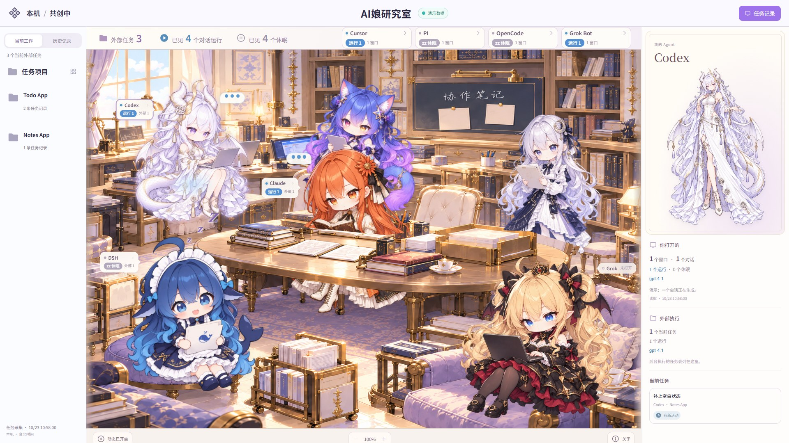

<div align="center">

# AI娘研究室

**你的 Claude、GPT、DeepSeek 现在在干嘛？看着她们干活心情舒畅。**

把你同时在用的几个 AI 编程助手，画进同一间会动的 2.5D 研究室。<br>
谁在埋头干活、谁趴着等你、谁刚交了卷，抬头看一眼就知道。

[English](#english) · Windows · 本地运行 · 只读观察 · 非商用开源


</div>

## 为什么做它

同时开着 Codex、Claude Code、DeepSeek，再往后台派几个命令行任务，很快就乱了：哪个窗口在跑，哪个在等你回话，派出去的活交了没有。一个个终端翻过去很累，状态面板又冷冰冰的，看久了也不想看。

研究室换了个办法：给每个 agent 一个形象，让大家坐进同一间屋子。她们的样子就是状态。在敲键盘的就是在干活，打瞌睡的就是在等你，蹦起来冒星星的就是刚交了卷。

## 会动，动作就是状态

- **在干活**：身子跟着打字的节奏晃，头顶冒出“…”打字气泡，面前的屏幕一亮一暗。
- **在等你**：歪着头打盹，慢慢地深呼吸，头顶一个接一个飘出 z。
- **刚交卷**：开心地蹦两下，身边闪一圈星光。
- **闲着**：每隔几秒会有人自己做个小动作，跳一下、左右张望、摇一摇、伸个懒腰。
- **拿不准就不演**：查不到她到底在干活还是在等你时，只做闲着的小动作，不装忙，也不装睡。

动画只用浏览器的 GPU 变换，几乎不占电脑资源。切到别的标签页、系统开了“减少动态”，或者点左下角的“动态”按钮，动作都会停下来。

## 闲着的时候，还会演小剧场


每隔半分钟左右，屋里会随机演一段小剧场，灵感来自社区二创里的常见梗：

- **打架**：Claude 小姐一本正经地讲计划，鲸鱼娘回一句“叽里咕噜说什么呢～”，喊着“冲呀！”冲向大桌，Claude 小姐也从桌后站起来迎上去。两人在烟尘云里扭打，打完各回各位，脸上都贴着创可贴。
- **降智**：龙娘眼睛变成白板、流着口水发呆，每句胡话后面还认真附上一行 SHA-256，然后晃晃悠悠起身飘到窗边，被鲸鱼娘一扳手“修好”。
- **干饭**：鲸鱼娘端出钢盆扒饭，米粒乱飞；睡着时就在梦里吃。
- **米粒事件**：一粒米落在 Claude 小姐的书上，“鲸鱼娘，果然是你！”
- **纸飞机**：鲸鱼娘给 Claude 小姐飞一张纸条，Claude 小姐红着脸回一句“……笨鱼。”
- **重置卡**：龙娘给一叠 RESET 卡挨个盖上“已阅”。
- **不舔**：主人在 Grok 的笔记本上求夸，Claude 小姐抢着说“您说得完全正确！”，Grok 只回一句“我不舔。”被提醒上次主人是对的，她冒着冷汗嘴硬：“那次是运气好。”
- **学术资料**：Grok 对着笔记本嘿嘿傻笑，屏幕上冒出一块带辣椒的马赛克。被 Claude 小姐撞见，她啪地合上：“学术资料。”“……学术资料还要打码？”“尺度大一点的学术。”
- **散步**：三位也会各自起身走走：龙娘去窗边透气，Claude 小姐到桌子另一头找书，鲸鱼娘溜到桌前问“Claude 小姐在看什么？”

Kimi 偶尔会沿桌子后面的过道走到黑板前，停一会儿再走回来。

小剧场只是逗趣，不代表谁的状态：状态标签照常显示真实情况，演完马上恢复原样；角色睡着时，会换成睡着也演得通的版本。动态关掉时不演。想马上看某一段，在浏览器控制台输入 `studioSkit('brawl')`（另外几段是 `daze`、`feast`、`rice`、`plane`、`reset`）。

[完整视频：六段连播，约 50 秒](docs/room-skits.mp4)

## 能看到什么



- **一眼看全场**：顶栏写着已见几个对话在运行、几个在休眠，后台有几个外部任务。
- **状态贴在身边**：每位角色头边有一张小标签，写着运行、休眠还是未打开。鼠标停上去展开，点一下看完整详情。
- **“你打开的”和“外部执行”分开算**：你自己开着的窗口和对话算一栏，派到后台跑的任务算另一栏，不混在一起数。
- **模型只在干活时出现**：确认她正在生成或跑工具，才显示当前用的模型。
- **查不到就写“未知”**：只能确认窗口开着、确认不了在不在生成时，显示“未知”。进程活着不算在干活。
- **当前 / 历史、按项目筛选、任务清单**：交过卷的任务留在历史里，验收状态单独显示。
- **不碰你的聊天**：对话标题和内容不进页面，也不进接口。

研究室只是一扇**只读的观察窗**：不派活、不重试、不结束任何进程，也不发提醒，只把看得到的状态如实画出来。

## 它怎么知道

| 来源 | 看得到 | 看不到 |
| --- | --- | --- |
| Codex App | 窗口数、已加载的本机对话、运行 / 休眠、当前轮用的模型 | 对话内容 |
| DSH（DeepSeek 桌面版） | 装上 `integrations/dsh-status-plugin/` 插件后，已加载会话的运行 / 休眠和当前请求的模型 | 没加载的会话 |
| Claude Code | 装上 `integrations/claude-code-hooks` 后，Claude Code 会话的运行 / 休眠和当前模型 | 没装时只知道窗口开着；对话内容始终不进页面 |
| Grok Bot | 窗口开没开；没有房间形象，状态在顶栏 | 是否正在生成，所以显示“未知” |
| Cursor、PI、OpenCode | 没有房间形象，状态在顶栏，来自 CLI Watch 记录的外部任务 | 对话内容 |
| [CLI Watch 0.1.0](https://github.com/captpascallv-dev/agent-baton/releases/tag/watch-v0.1.0) | 派给命令行执行者（Codex、Grok、Cursor、PI、OpenCode 等）的外部任务，以及近期有没有新活动 | 没有直接运行信号的任务，运行数量显示“未知” |

目前**只支持 Windows**：启动脚本、本机窗口观察和状态桥接都依赖 Windows。

## 角色

| Agent | 房间里的形象 | 原设计 |
| --- | --- | --- |
| Codex | GPT：白发龙角少女 | ZipZipPipe |
| Claude | 橙发持书少女 | ZipZipPipe |
| DSH | DeepSeek：鲸鱼女仆（鲸鱼娘） | 上善无形 |
| Grok / GrokBuild | 金发双马尾小恶魔 | ZipZipPipe |
| Grok Bot | 没有房间形象，状态显示在顶栏 | — |
| Cursor、PI、OpenCode | 没有房间形象，状态显示在顶栏 | — |

Gemini（蓝紫猫耳少女）和 Kimi（银发书记官）也住在研究室里，原设计同为 ZipZipPipe。她们暂时只是房间伙伴，不对应 agent 状态，闲着时也会自己做小动作。

社区角色都是非官方形象，详见 [CREDITS.md](CREDITS.md)。

## 快速开始

### 演示模式

除了 npm 依赖，不需要别的。

```powershell
npm ci
npm run build
npm run demo
```

浏览器打开 <http://127.0.0.1:4173/>，顶栏会标着“演示数据”。演示里干活、打盹、闲着三种样子都有。要换端口：`npm run demo -- --port 4180`。

### 真实模式

适配 CLI Watch 0.1.0。需要 Windows、Node.js，以及 .NET 8 SDK（用来编译桥接）。

1. 从 [CLI Watch 0.1.0 发布页](https://github.com/captpascallv-dev/agent-baton/releases/tag/watch-v0.1.0) 下载 `CLIWatch-0.1.0-win-x64.zip` 并解压。
2. 用解压出来的文件夹作为 `CliWatchRuntimeDirectory`，先构建网页，再构建桥接：

```powershell
npm ci
npm run build
dotnet build bridge/StudioBridge.csproj -c Release -m:1 -p:UseSharedCompilation=false -p:CliWatchRuntimeDirectory="<解压后的 CLIWatch-0.1.0-win-x64 文件夹>"
```

3. 把 `config.example.json` 复制到项目旁的 `../ai-moe-studio-state/config.json`。`cliWatchRuntimeDirectory` 填同一个解压文件夹，`cliWatchConfig` 填该文件夹下的 `config/default.json`，再填上桥接程序的路径，然后：

```powershell
powershell -NoProfile -File .\Start-Studio.ps1
```

会编译的人也可以用 agent-baton 源码里的 `Build-CliWatch.ps1` 自己构建，把构建输出目录当作上面的解压文件夹。

浏览器会打开配置里的地址，默认 <http://127.0.0.1:4173/>。服务只监听本机，重复启动会复用已在运行的研究室。

只看演示、不接本机状态时，用 `Start-Studio.ps1 -Demo`。

## 授权

- **代码**：[MIT](LICENSE)。
- **美术素材**（房间背景、角色 Q 版与立绘、效果图和动图）：[CC BY-NC-SA 4.0](ASSETS-LICENSE.md)。**仅限非商业使用**；转载或改编请保留原作者署名、注明修改，并以相同协议共享。

本项目是**非商用开源**的同人作品，全程署名原作者。所有角色都是非官方形象，与 OpenAI、Anthropic、Google、Moonshot AI、xAI、DeepSeek **没有任何隶属或背书关系**；各品牌名称归各自所有者。

角色原作者或品牌方如对使用方式有任何意见，请提 Issue 联系，我们会第一时间调整或移除。

---

<a id="english"></a>

<div align="center">

# AI Moe Studio

**What are your Claude, GPT and DeepSeek up to right now? Watching them work just feels good.**

The AI coding agents you run side by side, drawn into one cozy, animated 2.5D research room.<br>
Who is heads-down working, who is waiting on you, who just handed in: one glance tells you.

</div>

## Why

Run Codex, Claude Code and DeepSeek at once, send a few command-line jobs to the background, and it gets messy fast: which window is busy, which one is waiting for your reply, did that background job hand in yet. Flipping through terminals is tiring, and status dashboards are so cold you stop looking at them.

The studio tries something else. Every agent gets a character, and they all sit in the same room. How she looks *is* her status: typing means working, dozing means waiting on you, hopping in a burst of sparkles means she just handed in.

## It moves, and the motion is the status

- **Working**: she bobs to a typing beat, a “…” typing bubble floats over her head, and the screen in front of her pulses.
- **Waiting on you**: she dozes with her head tilted, breathing slowly, while z's drift up one after another.
- **Just handed in**: two happy hops and a ring of sparkles.
- **Idle**: every few seconds someone does a little something on her own: a hop, a look around, a wiggle, a stretch.
- **No acting when unsure**: if the studio can't tell whether she is working or waiting, she only does idle moves. She never fakes being busy or asleep.

All motion is GPU transforms in the browser and costs next to nothing. It pauses in background tabs, when the system prefers reduced motion, or when you press the motion button at the bottom left.

## Between jobs, they put on little skits


About every half minute the room plays a random skit, riffing on popular fan-art gags:

- **Scuffle**: Miss Claude earnestly lays out the plan, the whale maid answers “blah blah, what are you even saying~”, and with a cry of “Charge!” she runs at the table while Miss Claude stands up behind it to meet her. The two vanish into a dust cloud, go back to their seats, and both end up with band-aids on their cheeks.
- **Brain fog**: the dragon girl goes blank-eyed and drools, dutifully signing every mumble with its SHA-256, then drifts over to the window until the whale maid fixes her with a thrown wrench.
- **Rice time**: the whale maid digs into a steel basin of rice, grains flying; asleep, she just dreams of it.
- **The rice grain**: a grain lands on Miss Claude's book. “Whale girl, I knew it was you!”
- **Paper plane**: a note flies over to Miss Claude, who blushes: “…silly fish.”
- **Reset cards**: the dragon girl stamps a stack of RESET cards one by one.
- **No flattery**: the owner fishes for a compliment on Grok's laptop. Miss Claude gushes “You're absolutely right!”; Grok only says “I don't do flattery.” Reminded that the owner turned out right last time, she breaks into a sweat and doubles down: “That was luck.”
- **Academic material**: Grok giggles at her laptop until a pixelated screen with a chili on it pops up. Caught by Miss Claude, she slams it shut: “Academic material.” “…academic material needs a mosaic?” “Very advanced academics.”
- **Strolls**: each of the three also gets up for a short walk: the dragon girl goes to the window for some air, Miss Claude fetches a book from the far end of the table, and the whale maid wanders over to ask what Miss Claude is reading.

Kimi now and then strolls along the aisle to the blackboard and back.

Skits are just for fun and never stand for anyone's status: the tags keep showing the real state, and everyone goes back to her real look the moment a skit ends. A sleeping character gets a version that works while she sleeps. Nothing plays with motion off. To see one right away, type `studioSkit('brawl')` in the browser console (the others are `daze`, `feast`, `rice`, `plane` and `reset`). The speech bubbles are in Chinese.

[Full video: all six skits, about 50 seconds](docs/room-skits.mp4)

## What you can see


- **The whole room at a glance**: the top bar shows how many conversations are seen running or sleeping, and how many background tasks exist.
- **Status right beside them**: each character has a small tag by her head saying running, sleeping or not open. Hover to expand it; click for full details.
- **"Opened by you" and "external runs" are counted apart**: the windows and conversations you opened are one column; tasks dispatched to run in the background are another.
- **The model only shows while she works**: the current model appears only when she is confirmed to be generating or running tools.
- **Unknown means unknown**: if a window is open but generation can't be confirmed, it says "unknown". A live process is not counted as working.
- **Current / history, project filter, task list**: handed-in tasks stay in history, with review status shown separately.
- **Your chats stay out**: conversation titles and content never reach the page or the API.

It is a **read-only window**: it never dispatches, retries or ends anything, and it sends no alerts. It only draws what it can actually see.

## How it knows

| Source | What it sees | What it doesn't |
| --- | --- | --- |
| Codex App | window count, loaded local conversations, running / sleeping, the current turn's model | conversation content |
| DSH (DeepSeek desktop) | with the `integrations/dsh-status-plugin/` plugin: running / sleeping and the requested model of loaded sessions | sessions that aren't loaded |
| Claude Code | with `integrations/claude-code-hooks` installed: whether a Claude Code session is running or sleeping, and its current model | without the hook, only that a window is open; conversation content never reaches the page |
| Grok Bot | whether the window is open; no figure in the room, status in the top bar | whether it is generating, so it shows "unknown" |
| Cursor, PI, OpenCode | no figure in the room; status in the top bar, from external tasks recorded by CLI Watch | conversation content |
| [CLI Watch 0.1.0](https://github.com/captpascallv-dev/agent-baton/releases/tag/watch-v0.1.0) | external tasks dispatched to command-line agents (Codex, Grok, Cursor, PI, OpenCode, …) and their recent activity | the running count of tasks without a direct run signal ("unknown") |

**Windows only** for now: the launcher, the local window observer and the status bridge all depend on Windows.

## Characters

| Agent | In the room | Original design |
| --- | --- | --- |
| Codex | GPT: white-haired dragon girl | ZipZipPipe |
| Claude | orange-haired book lover | ZipZipPipe |
| DSH | DeepSeek: whale maid | 上善无形 (Shangshan Wuxing) |
| Grok / GrokBuild | blonde twin-tail little devil | ZipZipPipe |
| Grok Bot | no figure in the room; status in the top bar | — |
| Cursor, PI, OpenCode | no figure in the room; status in the top bar | — |

Gemini (blue-violet cat girl) and Kimi (silver-haired archivist), also designed by ZipZipPipe, live in the room too. For now they are companions with no agent status, and they do their own idle moves.

All community characters are unofficial. See [CREDITS.md](CREDITS.md).

## Quick start

### Demo mode

Nothing beyond the npm dependencies.

```powershell
npm ci
npm run build
npm run demo
```

Open <http://127.0.0.1:4173/>. The top bar says “演示数据” (demo data), and the demo shows all three looks: working, dozing and idle. Another port: `npm run demo -- --port 4180`.

### Live mode

This studio is built against CLI Watch 0.1.0. You need Windows, Node.js, and the .NET 8 SDK (the bridge is compiled with it).

1. Download `CLIWatch-0.1.0-win-x64.zip` from the [CLI Watch 0.1.0 release](https://github.com/captpascallv-dev/agent-baton/releases/tag/watch-v0.1.0) and unzip it.
2. Use that unzipped folder as `CliWatchRuntimeDirectory`. Build the web app, then the bridge:

```powershell
npm ci
npm run build
dotnet build bridge/StudioBridge.csproj -c Release -m:1 -p:UseSharedCompilation=false -p:CliWatchRuntimeDirectory="<unzipped CLIWatch-0.1.0-win-x64 folder>"
```

3. Copy `config.example.json` to `../ai-moe-studio-state/config.json` next to the project. Set `cliWatchRuntimeDirectory` to the same unzipped folder, set `cliWatchConfig` to `config/default.json` inside that folder, fill in the bridge path, then run:

```powershell
powershell -NoProfile -File .\Start-Studio.ps1
```

People who compile from source can also build with `Build-CliWatch.ps1` in the agent-baton tree, and use that build output as the unzipped folder above.

Your browser opens the address in that config, <http://127.0.0.1:4173/> by default. The server listens on this machine only, and starting it again reuses the running studio.

For the demo without local status, run `Start-Studio.ps1 -Demo`.

## License

- **Code**: [MIT](LICENSE).
- **Art assets** (room, chibi sprites, portraits, screenshots and the animated preview): [CC BY-NC-SA 4.0](ASSETS-LICENSE.md). **Non-commercial use only**; keep the original credits, mark your changes, and share alike.

This is a **non-commercial** fan project that credits every original creator. All characters are unofficial, with **no affiliation with or endorsement by** OpenAI, Anthropic, Google, Moonshot AI, xAI or DeepSeek. Brand names belong to their owners.

If you are an original creator or a brand owner and have any concern about how your work is used, please open an issue and we will adjust or remove it promptly.
