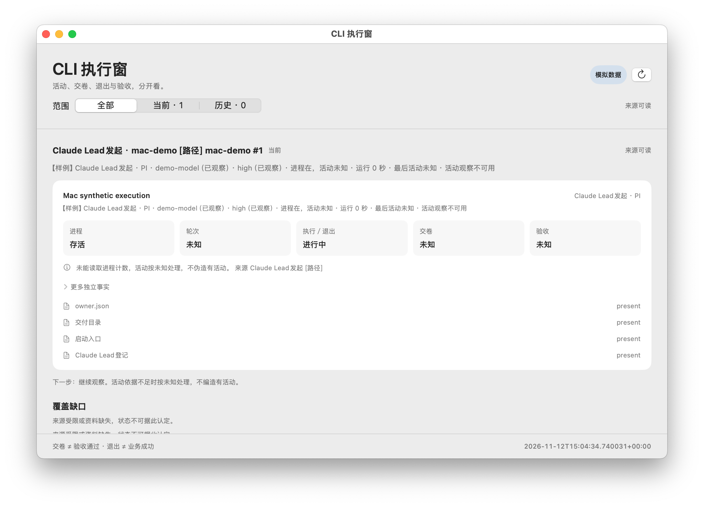
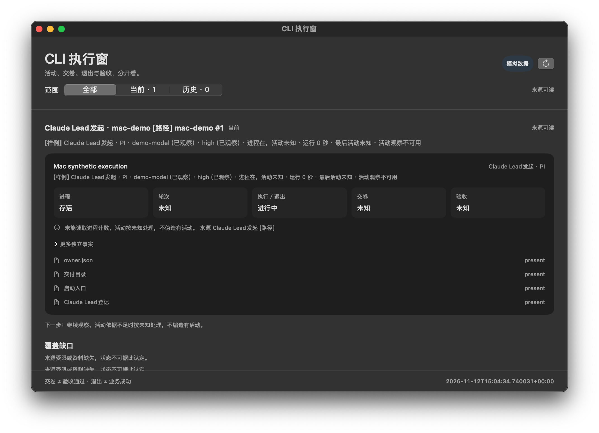

# CLI 执行窗 · macOS

官方 SwiftUI + AppKit 的普通原生窗口，不是菜单栏工具。不调用模型、不读取会话、凭据或真实额度；只消费 CliWatch.Cli 通过共享采集／归一化／投影链导出的 schema 1 JSON。

## 构建与运行

```sh
sh watch/macos/build.sh
watch/macos/build/CliWatchMac.app/Contents/MacOS/CliWatchMac
```

默认只读：`~/Library/Application Support/AgentBatonWatch/watch-snapshot.json`。可传 `--snapshot FILE`。每 5 秒重新读文件；读取失败明确显示上次已知或未知，不猜测结果。

离线演示先由 CliWatch.Cli 的 `--demo --output-dir DIR` 生成共享投影，再运行：

```sh
watch/macos/build/CliWatchMac.app/Contents/MacOS/CliWatchMac --snapshot DIR/watch-snapshot.json --appearance light
```

`--appearance light|dark` 仅改变本应用。省略则跟随系统；不修改系统外观。

## 展示边界

- 当前／历史仅用共享投影 `project.isCurrent`（共享 Windows CurrentList 投影），不重建状态机。
- 各任务的进程、轮次、执行／退出、交卷、验收、传递、回执、负责人处理、采纳、目标分别显示原投影值。
- 不把退出 0、交卷或 inactive 当作验收通过。未提供的事实保持未知。
- 来源质量沿用共享投影；文件读取错误不会伪装刷新成功。
- 不提供任务派发、执行、插件设置或文件跳转动作。

## 精确截图

启动后输出 `WATCH_WINDOW_ID` 与窗口大小。只允许用该本应用窗口 ID 截图；不要捕捉桌面、其他应用或账号页面。系统屏幕录制许可仍适用，不绕过拒绝。分别启动浅色和深色得到自己的演示窗口截图，不以模拟数据声称真实模型验证成功。

时间新鲜度仅用于展示告警：written_at_utc 超过 60 秒、比本机时钟超前 30 秒以上或无法解析时，明确显示已过期／当前未知，保留原事实为已有记录，不重新推断活动或业务结果。

### 原生窗口截图（假执行者）




仅任务自建假执行者；来源限制与活动计数未知如实显示，不是真实模型或验收成功证明。
